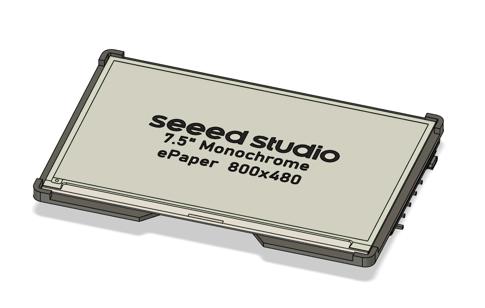
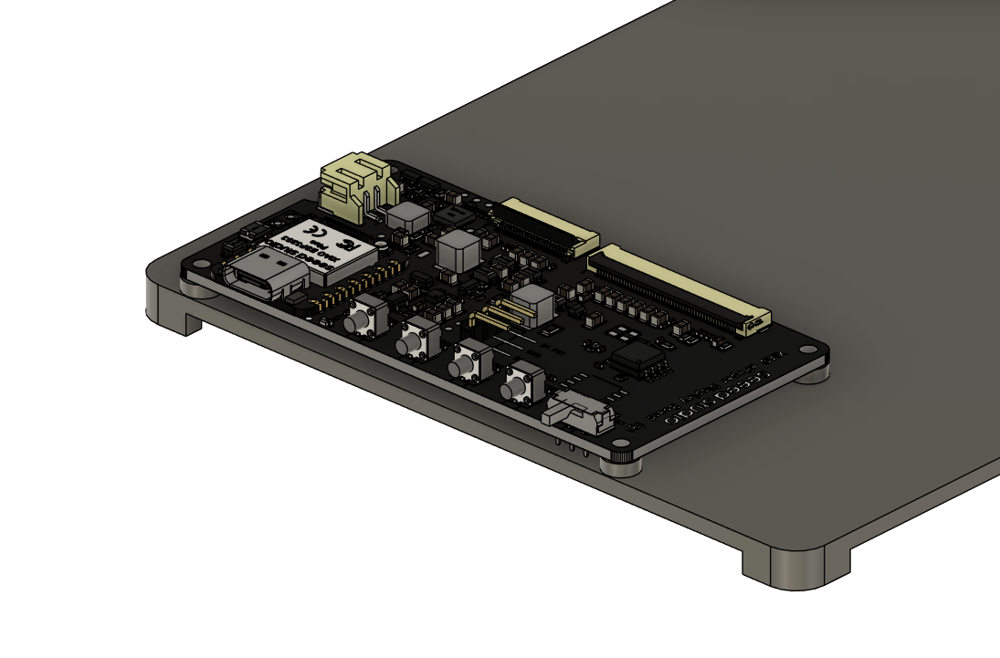
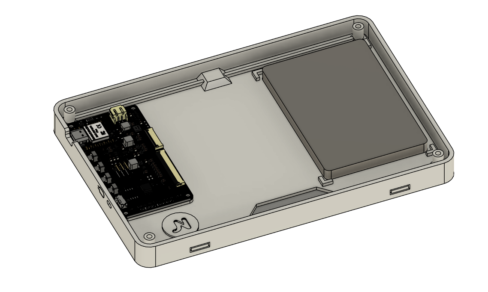
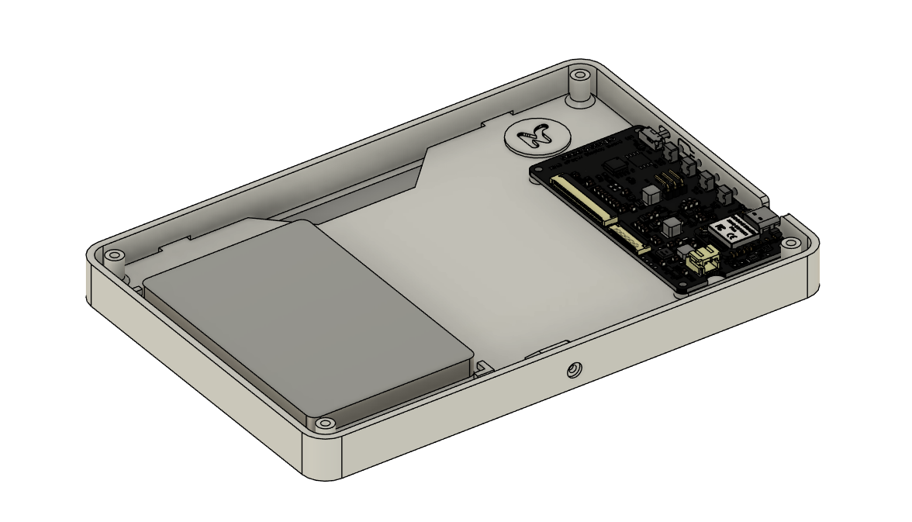
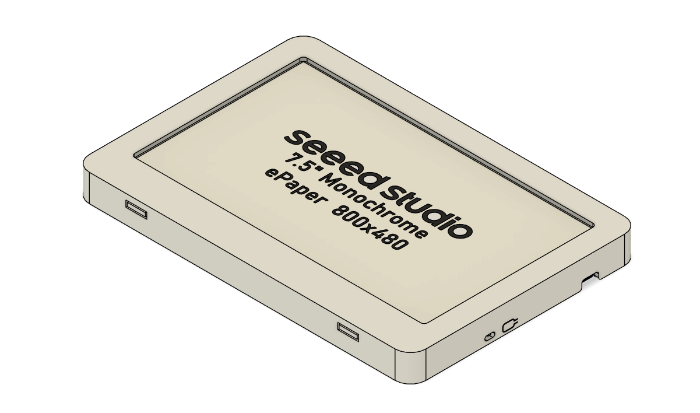

# November 24: Designed epaper backplate in Fusion

I got the 3d model for the epaper panel and the pcb, so i worked on the backplate for the epaper panel and designed some screw mounts for the pcb board. Had to scratch my head for the clearance because you know epaper are super fragile.

**Total time spent: 1 hours**

# November 25: Worked on backplate and case in Fusion

Today i added the battery bracket onto the backplate, added screw lock and clip for the backplate so it can be secured on the case, added type c connector and button cutout on the case, and optitmised the overall case thickness from ~20mm to 17mm. Took me a while to design the backplate mount for the case because i literally have no where to put screws, so i can only make a clip.  

**Total time spent: 3 hours**
